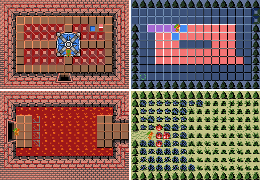

Combo triggers
==============

Combo triggers let a combo react to things that happen in the game, such as being hit by a weapon,
being stepped on, or a timer running out. In response, the combo can trigger secrets, change into
another combo, play a sound or spawn an item. You can build many puzzles and simple cutscenes
with triggers instead of scripts.

         path changing color as the player walks it, a floor appearing as the player comes near,
         and fire spreading through bushes
   :class: dark-light lightbox ct-header
   :align: center

Triggers are edited in the Combo Editor's ``Triggers`` tab. Press ``Add`` to create a trigger, or
select a trigger in the list and press ``Edit``. Both open the Combo Trigger Editor. A combo can
have up to 255 triggers, and each one has an optional ``Label`` to tell them apart.

For what each option does, click the ``?`` button next to it in the editor, or see the table of
every option in :doc:`/tutorials/combo_triggers_reference`. To see triggers in action, open the
`example quest`_ that comes with ZQuest Classic.

You can also edit the triggers for the current screen via the visual diagram in
``Screen > Combo Triggers`` :since:`3.0`.

.. note::
   This page describes 3.0. Options that only some versions have are marked with the versions
   that have them: :since:`3.0` for an option that's new in 3.0, and :since:`3.0, 2.55.17+` for
   one that 2.55 also got in 2.55.17. Sections that are new in 3.0 say so at the top. The other
   ways 2.55 differs, such as having one trigger per combo, are listed in `Differences in 2.55`_.

Causes, conditions and effects
------------------------------

Every trigger is made of three kinds of settings. In the editor, cause names usually end with an
arrow (``Step->``), and effect names start with one (``->LevelState``).

* **Causes** make the trigger fire. Examples: ``Step->``, ``Push->``, ``Enemies->``, ``Timer``,
  and the weapons checked in the ``Weapons`` tab, such as ``Sword`` or ``Arrow``.
* **Conditions** must all be true for the trigger to do anything, but never make it fire on their
  own. Examples: ``Proximity``, ``Req Item``, the counter ``Require >=``, required screen states.
  Most of them are in the ``Conditions``, ``Counter / Item / Enemy`` and ``Level / Screen Based``
  tabs.
* **Effects** are what happens when it fires. Examples: ``Triggers Secrets``, ``Combo Change``,
  ``SFX``, ``Spawn Item``, ``->LevelState``.

The diagrams on this page draw causes as purple pills, conditions as amber dashed boxes and
effects as teal boxes, with each combo's triggers stacked inside its box.

A trigger with no cause never fires, and a trigger with no effect does nothing. The editor's
``Warnings`` button warns about both :since:`3.0` (see `Debugging triggers`_).

What happens when a trigger fires
---------------------------------

When a cause fires a trigger, the engine:

1. Checks the conditions. If any condition fails, the trigger stops here and shows its
   ``Fail String`` :since:`3.0`, if it has one.
2. Checks the ``Cooldown``. If the trigger fired recently and its cooldown hasn't run out, steps
   3 and 4 are skipped. The ``Weapon Effects`` (see `Weapons`_) still happen.
3. Runs the combo type's own behavior, if ``->ComboType Effects`` is checked (see
   `Combo type behavior`_).
4. Runs the effects: secrets, sounds, items, enemies, states, the combo and CSet change, and so
   on. Running the effects also fires every other combo with the same ``Copycat`` number (see
   `Copycats`_), and starts the ``Cooldown``.

Combo type behavior
-------------------

Some combo types do things without any triggers. The player can open a chest or read a
signpost, and the combo type handles it. ``->ComboType Effects`` lets a trigger do the same, so a
chest can open when its trigger fires. ``ComboType Causes->`` :since:`3.0` works the other way
around, letting the combo type's own event fire the trigger, for example when the player falls
into a pitfall. Both are grayed out for combo types that don't support them.

To make a combo react *only* to its triggers (for example, a bush that a sword can't cut), check
``Only Gen Triggers`` in the Combo Editor's ``Triggers`` tab.

Combos with more than one trigger
---------------------------------

.. versionadded:: 3.0

When something happens to a combo, its triggers are checked from top to bottom, and every trigger
with a matching cause fires. To choose between triggers that share a cause, give them different
conditions.

Two things stop the rest of the list from firing:

* A trigger with ``Cancel Further Triggers`` checked whose conditions pass, even if its
  ``Cooldown`` hasn't run out.
* A trigger that changes the combo into a different one. The rest of the old combo's list is
  skipped.

Use ``Up``/``Down`` in the ``Triggers`` tab to reorder them, and ``Summarize All`` to read every
trigger on the combo as plain text.

Causes that keep firing
-----------------------

Some causes fire once each time something happens. ``Secrets->``, for example, fires once when
the screen's secrets are triggered. Weapon hits can fire a trigger more than once (see
`Weapons`_).

Many others fire **every frame** for as long as they are true:

* ``Always Triggered``. By default this only works for combos on layer 0 and for FFCs. The quest
  rules ``Auto Combos Work On Layer 1``, ``...On Layer 2`` and ``...On All Layers`` extend it to
  other layers.
* ``Step->``, ``Swim->`` :since:`3.0` and ``Dive->``, and their ``(Sensitive)`` versions: every
  frame the player stands, swims or dives on the combo.
* ``Enemies->``: every frame once the screen's enemies are dead. On a screen with no enemies,
  that's every frame from the start.
* ``TrigGroup Less->`` and ``TrigGroup Greater->`` (see `Trigger groups`_).
* ``Light On->`` and ``Light Off->``: whether a light beam is hitting the combo. On a screen
  without a ``Spotlight`` combo nothing is lit, so ``Light Off->`` fires every frame.
* ``Lens On->`` and ``Lens Off->``: whether the Lens of Truth is in use. Only lens items with
  ``Triggers Lens Trigflag`` checked count. If the lens item doesn't have that flag,
  ``Lens Off->`` keeps firing even while the lens is on.

Two causes repeat on a schedule instead. ``Push->`` fires again every ``Push Time`` :since:`3.0`
frames while the player keeps pushing. ``Timer`` fires every ``n`` frames until the combo changes.
A trigger with a ``Timer`` and a weapon cause fires on the timer *and* whenever a weapon hits it.
To only fire when hit, but never faster than a set rate, use a ``Cooldown`` instead of a
``Timer``.

A trigger with an every-frame cause and an effect like ``Triggers Secrets`` or ``SFX`` repeats
that effect 60 times a second. A sound that restarts every frame plays as constant noise. To fire
only once, give the trigger a way to switch itself off:

* a ``Combo Change`` to a combo that doesn't have this trigger,
* a ``Cooldown``, or
* a condition that becomes false once the trigger has done its job. For example, a trigger that
  sets permanent secrets can list ``Secrets`` in ``Unreq States`` :since:`3.0` under
  ``Level / Screen Based > Screen State / ExState``.

.. _combo-triggers-weapons:

Weapons
-------

The ``Weapons`` tab has four subtabs:

* ``LWeapons``: the player weapons that fire the trigger, and the ``Min Level`` they need.
* ``EWeapons``: the enemy weapons that fire the trigger.
* ``Other``: burning weapons, by fire strength, and ``Only Grounded Weapons``.
* ``Weapon Effects``: effects on the weapon itself, like destroying it or setting it on fire.

A torch that lights passing arrows uses ``Arrow`` (``LWeapons``) as the cause and
``Ignite Weapon (Normal)`` (``Weapon Effects``) as the effect.

A weapon checks a combo's triggers every frame it touches the combo, not just the first frame.
Most triggers fire again each time. If a sword swing or a boomerang lingers on a combo whose
trigger plays an ``SFX``, the sound plays many times. A trigger that spawns an item spawns many
items.

A weapon stops firing a combo's triggers at that position once one of them triggers secrets,
changes the combo or its CSet, changes a LevelState or GlobalState, has a copycat or
``->Large Copycat``, or uses ``->ComboType Effects`` on a Generic combo or a combo type with an
effect of its own (a chest, bush, lock block, switch, step, warp, sign, ...). After that, only
the triggers' ``Weapon Effects`` still happen for that weapon. Other copies of the combo still
react to it.

To fire a trigger only once per weapon, check ``Once Per Weapon`` :since:`3.0, 2.55.18+` in the
``Weapon Effects`` tab. It only stops that trigger: the combo's other triggers still fire every
frame the weapon touches it. There are other ways too. For a sound, ``No Restart`` :since:`3.0` in the
``SFX`` tab makes it play through instead of starting over. ``Kill Triggering Weapon`` stops the
weapon there (except a sword or hammer), and a ``Cooldown`` longer than the weapon stays on the
combo limits how often the trigger fires.

Weapons don't have to come from the player or enemies. A ``Shooter`` combo shoots weapons, and
those can fire weapon triggers on other combos. The example quest's "Lights Out" puzzle and
spreading fire work this way.

``Weapon Separate Triggers`` splits the trigger in two. When a weapon fires it, only the
``Weapon Effects`` happen, even if the trigger's conditions fail or its cooldown hasn't run out.
Everything else (secrets, combo change, sounds, ...) happens only when a non-weapon cause fires
it, so a trigger whose only causes are weapons can never trigger secrets.

Exception: when the quest rule ``'Burning' triggers don't count as 'weapon triggers'`` is on, the
burning causes in ``Weapons > Other`` don't count as weapons at all. They run everything *except*
the ``Weapon Effects``, so they can't destroy or ignite the burning weapon. Quests made before that
rule existed have it on.

Weapons fire triggers on layers 1 and up only when the quest rules
``Custom Combos Work On Layers 1 And 2`` or ``Custom Combos Work On All Layers`` are on. Every
ruleset turns both on, but an older quest may have them off. The burning causes work on every
layer either way.

.. _combo-triggers-trigger-groups:

Trigger groups
--------------

Trigger groups count how many combos on the screen belong to a group. The classic use is "light
every torch to open the door".

``Contributes To TrigGroup`` (in the ``States`` tab) adds the combo to the group set in
``Trigger Group``. A trigger used only for this needs no cause or
effect. What counts:

* every placed copy of the combo, on any layer, and as an FFC (except one with ``Is a Changer``
  checked),
* across the whole screen, or the whole region in a scrolling region,
* once per trigger with this checked, so a combo with two such triggers counts twice.

If nothing on the screen contributes to a group, its count is 0. Give each puzzle its own group
number when a screen has several, or when a scrolling region needs separate puzzles in different
parts.

Two causes react to the count:

* ``TrigGroup Less->`` fires when the group's count is less than ``Trigger Group Val``.
* ``TrigGroup Greater->`` fires when the count is greater than ``Trigger Group Val``.

The count is updated whenever a combo changes. Both causes are checked every frame, so they are
`causes that keep firing`_.

Example: a torch puzzle
^^^^^^^^^^^^^^^^^^^^^^^

"Light every torch to trigger secrets" takes three combos, placed one after another in the combo
list, because a ``Combo Change`` of 1 means "change into the next combo":

.. note::
   In 2.55 a combo has only one trigger, so the waiting lit torch is set up differently. See
   `Differences in 2.55`_.

* **Unlit torch.** Two triggers:

  1. cause ``Normal Fire`` (in ``Weapons > Other``), effect ``Combo Change`` 1, so it turns into
     the waiting lit torch when fire touches it.
  2. ``Contributes To TrigGroup``, with ``Trigger Group`` 0. This needs no cause or effect.

* **Lit torch (waiting).** Two triggers:

  1. causes ``Arrow`` and ``Boomerang`` (in ``Weapons > LWeapons``), effect
     ``Ignite Weapon (Normal)``, so arrows and boomerangs that pass through it catch fire and can
     light other torches.
  2. cause ``TrigGroup Less->`` with ``Trigger Group`` 0 and ``Trigger Group Val`` 1, effects
     ``Triggers Secrets`` and ``Combo Change`` 1.

* **Lit torch (done).** Only the ``Ignite Weapon (Normal)`` trigger.

.. raw:: html
   :file: combo_triggers/diagram_torch.svg

The group counts the unlit torches. When the last one is lit, the count drops to 0 and each
waiting lit torch fires once: it triggers secrets and changes into the done lit torch, which
doesn't check the group. Without that change, the lit torches would keep firing every frame and
the secret sound would restart constantly.

Keeping ``Contributes To TrigGroup`` on its own trigger, with a ``Label`` like
"Contributes: TrigGroup 0", makes the setup easier to read.

Things to watch for:

* The fire strengths have to match. A weapon lit with ``Ignite Weapon (Normal)`` only counts as
  ``Normal Fire``, so if the unlit torch's cause is ``Strong Fire``, the lit torch needs
  ``Ignite Weapon (Strong)``.
* A candle's flame only counts as ``Normal Fire`` when it burns out, about a second and a half
  after it is placed, unless the quest rule ``Burn Flags Are Triggered Instantly`` is on. To light
  a torch as soon as the flame touches it, also check ``Fire`` in the ``LWeapons`` tab.

.. _combo-triggers-copycats:

Copycats
--------

Combos that share a ``Copycat`` number (``States`` tab) fire together. Each copy still checks its
own conditions, so a condition on a copy (such as ``Proximity``) can stop that copy from firing.
Put conditions on the trigger that starts the chain instead.

On screen 02 of the `example quest`_, stepping on a floor switch makes two shooters fire through a
copycat. The switch's trigger has the conditions, and the shooters only have the copycat cause:

.. raw:: html
   :file: combo_triggers/diagram_floor_switch.svg

``->Large Copycat`` and ``Large Copycat->`` :since:`3.0` do the same, limited to the combos that
make up one large combo.

.. _combo-triggers-states:

States
------

Triggers can read and set several kinds of saved state, so a puzzle can remember that it was
solved:

* ``ExState``: one of 32 extra states per screen. ``ExDoor`` is the same thing for the extra
  door states on each side of the screen. Setting a door state also sets the matching state on
  the neighboring screen: an ``ExDoor`` on the up side sets the same index on the down side of
  the screen above.
* ``LevelState`` and ``GlobalState``: on/off switches. LevelStates are shared by every screen in
  a level, GlobalStates by the whole game. ``->LevelState`` toggles one. ``LevelState->`` fires
  when it is toggled, and when the player enters a screen while it is on. ``->GlobalState`` and
  ``GlobalState->`` work the same way.
* Position states :since:`3.0` (``Level / Screen Based`` tab): 8 states that belong to one combo
  position on the screen, rather than to the whole screen.

These can also be required or forbidden as conditions :since:`3.0`. GlobalStates are in the
``States`` tab, and LevelStates, screen states, ExStates and position states are in the
``Level / Screen Based`` tab.

A trigger that sets an ExState or ExDoor also *reacts* to it. If the state is already set when
the screen loads, the combo's triggers fire at once, but only their combo/CSet change,
``Reset Anim``, copycat and ``->Large Copycat`` :since:`3.0` run. While the state is set, the
combo's triggers only ever make these changes, whatever fires them.

The locked doors on screen 02 of the `example quest`_ work this way. The door's trigger sets
``ExDoor Right 1``, which is also one of its causes. When the player comes back, the state is
already set, so the door changes into the open door again. Only the ``Combo Change`` runs then: no
sound plays and no key is used.

.. raw:: html
   :file: combo_triggers/diagram_locked_door.svg

This is how an opened door stays open, and it can make any change permanent. For example, to
fill a pit by pushing a block into it, give the pit (a ``Pitfall`` combo) a
``Block (Same Layer)->`` :since:`3.0` trigger that sets an ExState and changes the pit into a
filled pit. The block falls into the pit, and the trigger turns the pit into the filled pit. When
the player comes back, the ExState is already set, so the pit turns into the filled pit again.
The ExState has to be on the pit's own trigger, because only the combos placed on the screen react
to ExStates, not the combos they would change into.

Helper combos
-------------

.. versionadded:: 3.0

A trigger doesn't need to be on a visible combo. Check ``Only Visible In Editor`` in the Combo
Editor's ``Basic`` tab to make a combo that only the editor draws. Give it a recognizable tile,
such as a music note, and place it on a layer.

Example: boss music. Give a helper combo a ``Screen Loads->`` trigger (or ``Timer``, to wait a
moment) that sets ``Music`` to the boss music and ``Set Music Refresh`` to ``Region``. Add
``Secrets`` to ``Unreq States`` under ``Level / Screen Based > Screen State / ExState`` so the
music doesn't play again after the boss is beaten.

The ``Unreq States`` check only works if the screen's secrets are permanent. On a Dungeon DMap
they aren't, unless the quest rule ``Allow permanent secrets on Dungeon-type dmaps`` is on.
Without it, give the helper combo a second trigger, with the ``Enemies->`` cause, that sets an
ExState, and list that ExState in the music trigger's ``Unreq ExStates`` instead.

Copying triggers
----------------

.. versionadded:: 3.0

The ``Clipboard`` buttons in the ``Triggers`` tab copy triggers as JSON text. You
can paste a trigger into another combo, another quest or another open editor, or share it in a
message.

* ``Copy`` puts the selected trigger on the clipboard. Hold Shift while clicking it to get the text
  with line breaks and indentation, which is easier to read.
* ``Paste`` replaces the selected trigger with the one on the clipboard.
* ``Paste New`` adds the trigger on the clipboard as a new one, either right after the selected
  trigger (``At Cursor``) or at the end of the list (``At End``).
* ``Summarize`` describes the trigger on the clipboard without pasting it. Use it to check a
  trigger someone shared before you paste it.

The text only lists the settings that differ from a new, empty trigger. All the checkboxes are
stored together as one encoded value, so change them in the editor, not in the text.

Debugging triggers
------------------

* ``Screen > Combo Triggers`` :since:`3.0` draws the current screen's triggers as a diagram like
  the ones on this page: every combo with triggers on the screen, its layers and its FFCs, the
  combos they change into, and the copycats, trigger groups, states and secrets that link them.
  Hover a combo to see where it's placed, and click it, or one of its triggers, to edit it. In a
  scrolling region, ``Whole Region`` draws every screen of the region; without it, the copycats
  and trigger groups note the combos on the other screens that use them, and clicking another
  screen in the picture moves to it.
* ``Summarize`` and ``Summarize All`` :since:`3.0` describe triggers in plain text: ``Summarize``
  in the Combo Trigger Editor for one trigger, ``Summarize All`` in the Combo Editor for all of a
  combo's. They're the quickest way to find a checkbox that was checked by mistake.
* The ``Warnings`` button :since:`3.0` at the bottom of the Combo Trigger Editor lists common setup
  mistakes, such as a trigger with no cause or no effect, or a sound that will play every frame
  (see `Causes that keep firing`_ and `Weapons`_). It's grayed out when there's nothing to warn
  about.
* While playing the quest, ``Cheat > Show/Hide Layer > Trigger Proximity`` :since:`3.0, 2.55.17+`
  draws the ``Proximity`` range of every trigger on the screen.
* ``Cheat > Show/Hide Layer > Trigger Log`` :since:`3.0`, or its cheat key (``T`` by default),
  prints what the triggers do as you play: which trigger fired, where, and what set it off (a
  weapon, ``Step->``, ``Copycat 3``, ...), with the triggers it set off in turn indented under it.
  When a trigger doesn't fire, it says why: the condition that failed and the values behind it
  (``the player is 40px away, needs less than 32px``), or that a weapon was the wrong level or the
  wrong kind of fire. A trigger that fires every frame is reported when it starts, after a second,
  and when it stops. It also reports trigger group counts as they change. It opens the console
  window, and also writes to ``allegro.log``. The latest lines also appear in the top left of the
  screen for a few seconds. Combos whose triggers just fired are outlined in yellow, and ones that
  failed a condition in red, fading out over half a second.
* If a screen keeps doing something on its own, such as repeating a sound or re-triggering
  secrets, look for a trigger with one of the `causes that keep firing`_.
* If triggers in an older quest don't work the way this page says, check the `Compat rules`_.

Example quest
-------------

ZQuest Classic comes with an example quest full of trigger setups:
``quests/examples/trigger_example.qst`` in the folder ZQuest Classic is installed in.
Play it to see each room work, then open it in the editor to see how it was built. Every trigger
in it has a ``Label`` that says what it does, such as ``TrigGroup 0 < 1 -> Trigger Secrets, Next``,
so ``Summarize All`` on a combo explains how a room is set up.

All the rooms are on Map 1. Many of the triggers are on combos placed on layers 1 to 3 rather
than on the screen itself. Those layers are Maps 2 to 4, so open the same screen number on those
maps to edit them. Screen numbers are in hexadecimal, as the editor shows them. Some of the rooms:

.. The animations below are made by scripts/update_trigger_example_animations.py from
   replays of the example quest. Rerun it after changing a room or its replay.

.. grid:: 1 1 2 2
   :gutter: 3

   .. grid-item-card:: Screen 00: Landing triggers

      .. image:: combo_triggers/room_00.webp
         :alt: Screen 00 of the example quest
         :loading: lazy
         :class: dark-light lightbox
         :align: center

      Landing on combos after a jump (``Land Here->``, ``Land Anywhere->``), with a different
      result when the player has the Stomp Boots. ExStates remember the result.

      +++
      Open in the `web editor <https://web.zquestclassic.com/create/?open=quests/examples/trigger_example.qst&map=0&screen=0>`__ or `web player <https://web.zquestclassic.com/play/?test=/quests/examples/trigger_example.qst&dmap=0&screen=0>`__

   .. grid-item-card:: Screen 01: Ledge jump

      .. image:: combo_triggers/room_01.webp
         :alt: Screen 01 of the example quest
         :loading: lazy
         :class: dark-light lightbox
         :align: center

      Jumping down a ledge by pushing against it, built with ``Push->`` and a copycat.

      +++
      Open in the `web editor <https://web.zquestclassic.com/create/?open=quests/examples/trigger_example.qst&map=0&screen=1>`__ or `web player <https://web.zquestclassic.com/play/?test=/quests/examples/trigger_example.qst&dmap=0&screen=1>`__

   .. grid-item-card:: Screen 02: Floor switches and doors

      .. image:: combo_triggers/room_02.webp
         :alt: Screen 02 of the example quest
         :loading: lazy
         :class: dark-light lightbox
         :align: center

      Floor switches (``Step->``) that make shooters fire through copycats, and doors opened with
      a bomb or a key that stay open through ExDoors.

      +++
      Open in the `web editor <https://web.zquestclassic.com/create/?open=quests/examples/trigger_example.qst&map=0&screen=2>`__ or `web player <https://web.zquestclassic.com/play/?test=/quests/examples/trigger_example.qst&dmap=0&screen=2>`__

   .. grid-item-card:: Screen 03: Timers and teleport pads

      .. image:: combo_triggers/room_03.webp
         :alt: Screen 03 of the example quest
         :loading: lazy
         :class: dark-light lightbox
         :align: center

      ``Timer`` triggers, ``Shutter->``, ``Screen Loads->`` with conditions, teleport pads made with
      copycats, and a combo that heals the player nearby.

      +++
      Open in the `web editor <https://web.zquestclassic.com/create/?open=quests/examples/trigger_example.qst&map=0&screen=3>`__ or `web player <https://web.zquestclassic.com/play/?test=/quests/examples/trigger_example.qst&dmap=0&screen=3>`__

   .. grid-item-card:: Screen 04: Spinner tiles

      .. image:: combo_triggers/room_04.webp
         :alt: Screen 04 of the example quest
         :loading: lazy
         :class: dark-light lightbox
         :align: center

      Spinner tiles that grab the player and turn them (``Step->`` with the stun, player position
      and facing effects), and swap when a LevelState toggles.

      +++
      Open in the `web editor <https://web.zquestclassic.com/create/?open=quests/examples/trigger_example.qst&map=0&screen=4>`__ or `web player <https://web.zquestclassic.com/play/?test=/quests/examples/trigger_example.qst&dmap=1&screen=4>`__

   .. grid-item-card:: Screen 10: Button prompt and jump height

      .. image:: combo_triggers/room_10.webp
         :alt: Screen 10 of the example quest
         :loading: lazy
         :class: dark-light lightbox
         :align: center

      A button prompt (``Press A``), ExStates, and triggers that depend on how high the player has
      jumped.

      +++
      Open in the `web editor <https://web.zquestclassic.com/create/?open=quests/examples/trigger_example.qst&map=0&screen=16>`__ or `web player <https://web.zquestclassic.com/play/?test=/quests/examples/trigger_example.qst&dmap=0&screen=16>`__

   .. grid-item-card:: Screen 12: Torch puzzle and crystal switch

      .. image:: combo_triggers/room_12.webp
         :alt: Screen 12 of the example quest
         :loading: lazy
         :class: dark-light lightbox
         :align: center

      The torch puzzle from `Example: a torch puzzle`_, using ``Strong Fire`` and
      ``Ignite Weapon (Strong)``. Its unlit torch also checks ``Only Grounded Weapons``, and both
      torches change when secrets are triggered some other way (``Secrets->``). Also a crystal
      switch that sets a GlobalState for 600 frames, and combos that react to it.

      +++
      Open in the `web editor <https://web.zquestclassic.com/create/?open=quests/examples/trigger_example.qst&map=0&screen=18>`__ or `web player <https://web.zquestclassic.com/play/?test=/quests/examples/trigger_example.qst&dmap=0&screen=18>`__

   .. grid-item-card:: Screen 13: Path puzzle

      .. image:: combo_triggers/room_13.webp
         :alt: Screen 13 of the example quest
         :loading: lazy
         :class: dark-light lightbox
         :align: center

      Step on every tile exactly once. Built from ``Step->``, copycats and a trigger group.

      +++
      Open in the `web editor <https://web.zquestclassic.com/create/?open=quests/examples/trigger_example.qst&map=0&screen=19>`__ or `web player <https://web.zquestclassic.com/play/?test=/quests/examples/trigger_example.qst&dmap=1&screen=19>`__

   .. grid-item-card:: Screen 14: Lights Out

      .. image:: combo_triggers/room_14.webp
         :alt: Screen 14 of the example quest
         :loading: lazy
         :class: dark-light lightbox
         :align: center

      Stepping on a tile flips it and its neighbors.

      +++
      Open in the `web editor <https://web.zquestclassic.com/create/?open=quests/examples/trigger_example.qst&map=0&screen=20>`__ or `web player <https://web.zquestclassic.com/play/?test=/quests/examples/trigger_example.qst&dmap=1&screen=20>`__

   .. grid-item-card:: Screen 15: Colored torches

      .. image:: combo_triggers/room_15.webp
         :alt: Screen 15 of the example quest
         :loading: lazy
         :class: dark-light lightbox
         :align: center

      Four colored torches that light when the matching keyhole elsewhere in the dungeon toggles
      its LevelState. An ``Always Triggered`` trigger that requires all four LevelStates then
      triggers secrets.

      +++
      Open in the `web editor <https://web.zquestclassic.com/create/?open=quests/examples/trigger_example.qst&map=0&screen=21>`__ or `web player <https://web.zquestclassic.com/play/?test=/quests/examples/trigger_example.qst&dmap=1&screen=21>`__

   .. grid-item-card:: Screen 16: Proximity: appearing

      .. image:: combo_triggers/room_16.webp
         :alt: Screen 16 of the example quest
         :loading: lazy
         :class: dark-light lightbox
         :align: center

      Combos that change into the next combo when the player comes within 48 pixels:
      ``Always Triggered`` with a ``Proximity`` condition.

      +++
      Open in the `web editor <https://web.zquestclassic.com/create/?open=quests/examples/trigger_example.qst&map=0&screen=22>`__ or `web player <https://web.zquestclassic.com/play/?test=/quests/examples/trigger_example.qst&dmap=1&screen=22>`__

   .. grid-item-card:: Screen 17: Proximity: disappearing

      .. image:: combo_triggers/room_17.webp
         :alt: Screen 17 of the example quest
         :loading: lazy
         :class: dark-light lightbox
         :align: center

      The same idea in reverse: combos change into the previous combo when the player comes within
      32 pixels.

      +++
      Open in the `web editor <https://web.zquestclassic.com/create/?open=quests/examples/trigger_example.qst&map=0&screen=23>`__ or `web player <https://web.zquestclassic.com/play/?test=/quests/examples/trigger_example.qst&dmap=1&screen=23>`__

   .. grid-item-card:: Screen 18: Spreading fire

      .. image:: combo_triggers/room_18.webp
         :alt: Screen 18 of the example quest
         :loading: lazy
         :class: dark-light lightbox
         :align: center

      Fire that spreads from bush to bush. A burning bush becomes a Shooter combo whose ``Timer``
      triggers shoot fire at its neighbors, then burn it out.

      +++
      Open in the `web editor <https://web.zquestclassic.com/create/?open=quests/examples/trigger_example.qst&map=0&screen=24>`__ or `web player <https://web.zquestclassic.com/play/?test=/quests/examples/trigger_example.qst&dmap=1&screen=24>`__

   .. grid-item-card:: Screen 20: Torches in the sky

      .. image:: combo_triggers/room_20.webp
         :alt: Screen 20 of the example quest
         :loading: lazy
         :class: dark-light lightbox
         :align: center

      Torches out on the clouds, lit from a distance. Lighting them all reveals a staircase that
      warps the player (``Step->`` with ``->ComboType Effects``).

      +++
      Open in the `web editor <https://web.zquestclassic.com/create/?open=quests/examples/trigger_example.qst&map=0&screen=32>`__ or `web player <https://web.zquestclassic.com/play/?test=/quests/examples/trigger_example.qst&dmap=0&screen=32>`__

   .. grid-item-card:: Screen 26: Armos statues

      .. image:: combo_triggers/room_26.webp
         :alt: Screen 26 of the example quest
         :loading: lazy
         :class: dark-light lightbox
         :align: center

      Touching one Armos statue wakes them all (copycat), starting boss music.

      +++
      Open in the `web editor <https://web.zquestclassic.com/create/?open=quests/examples/trigger_example.qst&map=0&screen=38>`__ or `web player <https://web.zquestclassic.com/play/?test=/quests/examples/trigger_example.qst&dmap=1&screen=38>`__

   .. grid-item-card:: Screen 25: Colored keys

      .. image:: combo_triggers/room_25.webp
         :alt: Screen 25 of the example quest
         :loading: lazy
         :class: dark-light lightbox
         :align: center

      Colored keys and keyholes that remove matching barriers, in screens 05, 06, 25 and 26. Here
      the red and blue keys go in, and the red barrier on the right disappears.

      +++
      Open in the `web editor <https://web.zquestclassic.com/create/?open=quests/examples/trigger_example.qst&map=0&screen=37>`__ or `web player <https://web.zquestclassic.com/play/?test=/quests/examples/trigger_example.qst&dmap=1&screen=37>`__

Screens 04, 15, 16, 17, 25 and 26 also start a short cutscene when entered, walking the player
in automatically. The screen 15 animation ends with one.

Quest rules
-----------

These quest rules change how triggers behave. They are in ``Quest > Options``, where
``Search QRs`` finds a rule by name.

* ``Custom Combos Work On Layers 1 And 2`` and ``Custom Combos Work On All Layers`` (``Combo``
  tab): let weapons fire triggers on combos on layers 1 and up (see `Weapons`_).
* ``Auto Combos Work On Layer 1``, ``...On Layer 2`` and ``...On All Layers`` (``Combo`` tab):
  let ``Always Triggered`` work on those layers (see `Causes that keep firing`_).
* ``Burn Flags Are Triggered Instantly`` (``Combo`` tab): a candle's flame counts as
  ``Normal Fire`` as soon as it is placed, not only when it burns out (see
  `Example: a torch puzzle`_).
* ``Allow permanent secrets on Dungeon-type dmaps`` (``Misc`` tab): lets ``Triggers Secrets``
  make a Dungeon DMap's secrets permanent (see `Helper combos`_).

Compat rules
^^^^^^^^^^^^

These rules in the ``Compat`` tab bring back old trigger behavior. Each is turned on
automatically for quests saved before the change it reverts. Turning one off gives you the
current behavior, but check first that nothing in the quest relies on the old one.

.. list-table::
   :header-rows: 1
   :widths: 25 50 25

   * - Rule
     - Effect
     - Enabled for quests saved before
   * - :ref:`Old FFC Functionality<globals_enum_member_qr_old_ffc_functionality>`
     - An FFC's triggers never fire. The rule also turns off other FFC features.
     - 2.55 Alpha 112
   * - :ref:`Old Bomb Hitboxes<globals_enum_member_qr_old_bomb_hitboxes>`
     - The outer ring of a bomb's explosion doesn't fire triggers.
     - 2.55 Alpha 114
   * - :ref:`Broken light beam hitbox<globals_enum_member_qr_broken_lightbeam_hitbox>`
     - ``Light On->`` and ``Light Off->`` on an FFC check the point 8 pixels right and down from
       its top-left corner, not its center. A ``Light Trigger`` combo (the combo type) that doesn't
       block light reflects light beams like a ``Mirror (4-Way)``.
     - 2.55 Alpha 119
   * - :ref:`'Burning' triggers don't count as 'weapon triggers'<globals_enum_member_qr_fire_level_triggers_arent_weapons>`
     - The burning causes don't count as weapons, so they run everything except the
       ``Weapon Effects`` (see `Weapons`_).
     - 3.0.0-prerelease.82 (so every 2.55 quest)
   * - :ref:`Inverted Dark Combo Triggers<globals_enum_member_qr_inverted_dark_combo_triggers>`
     - ``Req. Darkness`` and ``Req. No Darkness`` are swapped.
     - 3.0.0-prerelease.99 (so every 2.55 quest)
   * - :ref:`Broken Combo Change + 'Copycat' triggers<globals_enum_member_qr_broken_copycat_self_trigger>`
     - When a trigger changes the combo and has a copycat, the combo it changes into is fired by
       that same copycat right away.
     - 2.55.13, or 3.0.0-prerelease.157
   * - :ref:`Broken Combo Trigger Self-Triggering<globals_enum_member_qr_broken_self_triggering_triggers>`
     - A trigger's effects can fire the same trigger again, which can charge a cost twice or
       toggle a state on and straight back off.
     - 2.55.13, or 3.0.0-prerelease.160
   * - :ref:`Broken Pushblock Trigger Groups<globals_enum_member_qr_broken_pushblock_trigger_groups>`
     - A pushblock that is moving doesn't count toward trigger groups (see `Trigger groups`_).
     - 2.55.15, or 3.0.0-prerelease.181

.. _combo-triggers-differences-in-2-55:

Differences in 2.55
-------------------

Apart from the badged options and the sections that are new in 3.0, 2.55 differs in these ways:

* **One trigger per combo.** A combo has a single trigger, set directly in the Combo Editor's
  ``Triggers`` tab. A combo that needs two kinds of behavior puts all the causes on its one
  trigger, and uses ``Weapon Separate Triggers`` to keep the weapon causes apart. For example, the
  waiting lit torch in `Example: a torch puzzle`_ puts both causes on the same trigger and checks
  ``Weapon Separate Triggers``. Then a passing arrow only catches fire, and secrets come only from
  the trigger group cause.
* **Tabs.** There are fewer conditions, spread across the ``Other``, ``Counters`` and
  ``States/Spawning`` tabs. ``Copycat`` and ``Contributes To TrigGroup`` are in the
  ``States/Spawning`` tab, and ``Only Gen Triggers`` is in the ``Triggers > Effects`` tab.
* **Push.** ``Push->`` fires again every 8 frames while the player keeps pushing.
* **Copycats and weapons.** Having a copycat doesn't make a weapon skip the combo afterwards (see
  `Weapons`_).
* **Burning weapons.** The burning causes in ``Weapons > Other`` never count as weapons, as if the
  quest rule ``'Burning' triggers don't count as 'weapon triggers'`` were on (see `Weapons`_).
* **2.55.17 and earlier:** a weapon fires a combo's triggers once a frame for each corner of its
  hitbox that touches the combo, usually four times a frame. Fixed in 2.55.18.
